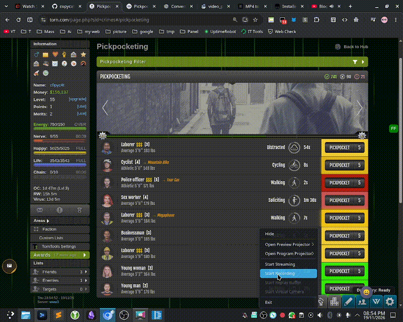

# Torn City Userscripts

A collection of custom userscripts for Torn City. Tools designed to improve gameplay, simplify faction management, provide useful statistics, and enhance the Torn interface.

<h2 align="center">Demo</h2>

  

## 📜 Script Directory

Browse the collection and click any script to view its source code and install it.

| Script | Description | API |
|---|---|:---:|
| [Chain Watcher](scripts/Chain_Watcher.js) | Monitors both faction chains, highlights activity, and plays an alert when the chain reaches 60 seconds. | Yes |
| [Cortex RW Auction Insights](scripts/Cortex_RW_Auction%20Insights-4.29.2.js) | Checks Ranked War auctions and helps evaluate fair item prices. | Check |
| [Crack Commander](scripts/Crack_Commander.js) | Assists with password cracking and previews potential rewards. | Check |
| [Custom Lists](scripts/Custom_Lists.js) | Create custom Friends, Enemies, and Hitlist lists without player-status checks or API usage. | No |
| [Director View](scripts/Director_View.js) | Company management tool with training and cost adviser features. | Check |
| [Egg Finder 1.1.0](scripts/Egg_Finder-1.1.0.user.js) | Easter event helper for locating hidden eggs. | Check |
| [Faction Navbar](scripts/Faction_Navbar.js) | Faction navigation enhancement. | Check |
| [FF Scouter V2 3.3](scripts/FF_Scouter_V2-3.3.user.js) | Displays player statistics using FF Scouter data. | External |
| [Heasley's Egg Navigator 1.6.2](scripts/Heasley's_Egg_Navigator-1.6.2.user.js) | Easter event helper for locating hidden eggs. | Check |
| [Pickpocket Helper](scripts/Pickpocket_Helper.js) | Pickpocket crime adviser with score tracking and rare item notifications. | Check |
| [Quick Bookmark Wheel](scripts/QuickBookmarkWheel.user.js) | Bookmark manager with a convenient wheel interface for quick access. | No |
| [Torn Activity Scanner](scripts/Torn_Activity_Scanner_Company_Faction_FF_Stats.js) | Looks up faction members and company activity, including last active status and FF scores. | Check |
| [Torn Chat Emoji](scripts/Torn_Chat_Emoji_Simple%20Floating%20Pane-1.0.js) | Adds a floating emoji panel to Torn chat. | No |
| [Torn Faction Vault & Armory Manager 2.3.41](scripts/Torn_Faction_Vault_%26_Armory_Manager-2.3.41.js) | Faction vault, armory, and management tools. | Check |
| [Torn Fast Slots 0.5](scripts/Torn_Fast_Slots-0.5.js) | Fast slot machine interface for Torn Casino. | Check |
| [Torn War Helper](scripts/TORN_War_HELPER.user.js) | War dashboard with an improved Ranked War overview. | Check |
| [Torn War Stuff Enhanced 2.1](scripts/Torn_War_Stuff_Enhanced-2.1.user.js) | Additional Torn war enhancements. | Check |
| [Wheel Bookmark](scripts/Wheel_Bookmark.js) | Bookmark wheel functionality. | Check |

## Installation

1. Install a userscript manager:
   - [Violentmonkey](https://violentmonkey.github.io/)
   - [Tampermonkey](https://www.tampermonkey.net/)
2. Click the script you want from the directory above.
3. Open the raw source file using GitHub's **Raw** button.
4. Install the script through your userscript manager.

## API Legend

| Label | Meaning |
|---|---|
| Yes | Uses an API. |
| No | Does not require API access. |
| External | Uses an external data source. |
| Check | API requirements need verification. |

## Disclaimer

These are independent community-made tools for Torn City. Features and API requirements vary between scripts.

Review script permissions and requirements before installation.

---

**Torn City Userscripts Collection**  
*Tools, enhancements, and utilities for Torn City.*